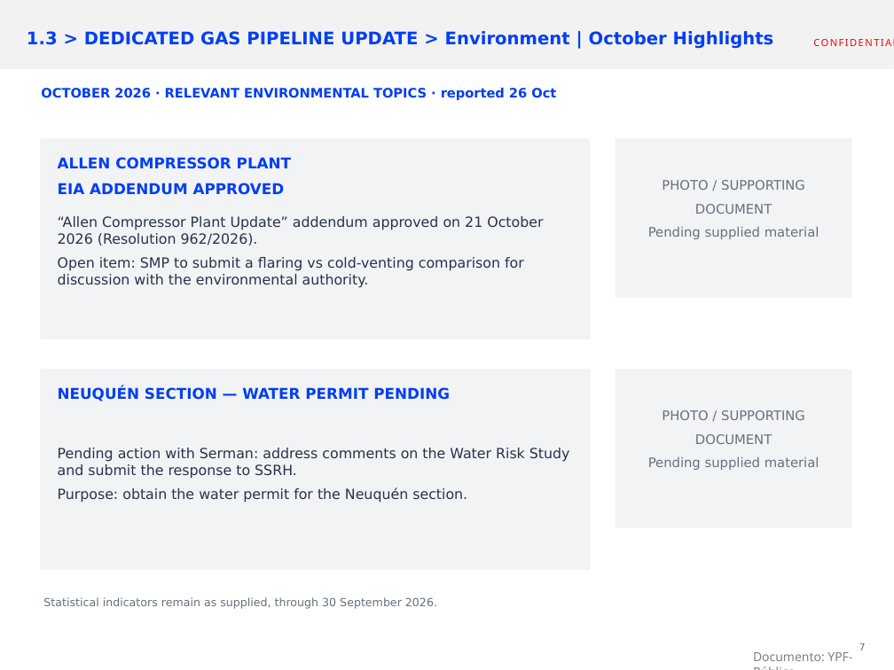

# Informe HSE — octubre 2026

Versión vigente: **v04, borrador de trabajo**, corte solicitado al **27/10/2026**.

- [PowerPoint editable v04](entregables/SMP_HSE_Octubre_2026_v04_AMBIENTE_ACTUALIZADO.pptx)
- [PDF para revisión](entregables/SMP_HSE_Octubre_2026_v04_AMBIENTE_ACTUALIZADO.pdf)
- [Registro de comentarios y decisiones](entregables/MEMORIA_REVISION_OCTUBRE_2026.md)
- [Presentación original conservada](original/2026.10.26_Technical%20Committee%20SMP%20No5_YPF%20slides_v2_3.pptx)

Se conservaron las series de los siete gráficos y los siete libros incrustados del original. Se quitaron ceros decimales innecesarios, manteniendo valores fraccionarios como 2.35 y 0.79.

Orden de edición: gráficos de seguridad → fotos y novedades de seguridad → gráficos ambientales reconstruidos de la captura → fotos y novedades de ambiente.

Las fotos y los temas relevantes de octubre están pendientes de Leandro Doglio. Los espacios para fotos son marcadores, no evidencia de actividades realizadas. Los valores de ambiente reproducen la captura suministrada y son históricos de agosto–septiembre.

Para descargar el PowerPoint desde su página de GitHub, utiliza **Download raw file**.

## Comprobación visual de capacitación

La lámina 4 muestra **2.87%**, en azul. Esta versión tiene un nombre nuevo para distinguirla de descargas anteriores.

## Novedades ambientales incorporadas en v04

Se mantiene la referencia estadística al 30/09 y todos los gráficos sin cambios, incluido el 2.87% de capacitación. La lámina 7 resume la aprobación de la adenda de Allen y su pendiente de Stack Frío, y la gestión con Serman ante SSRH por el permiso hídrico de Neuquén. Fuente: capturas de correos del 26/10/2026. No se afirma ausencia de incidentes ni aprobación del permiso hídrico.

