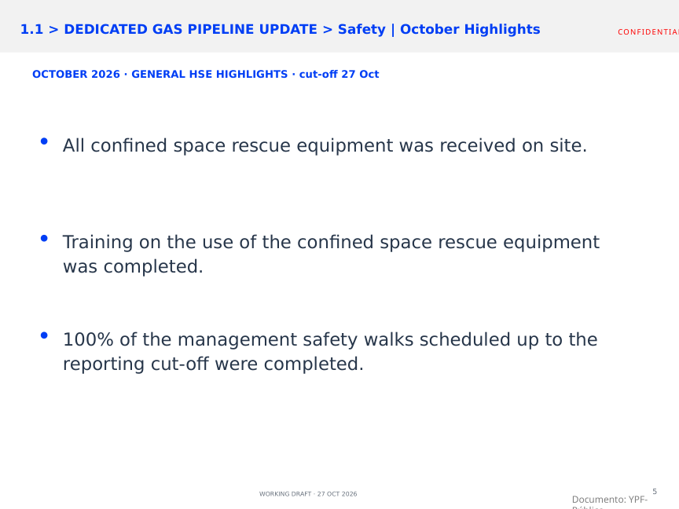
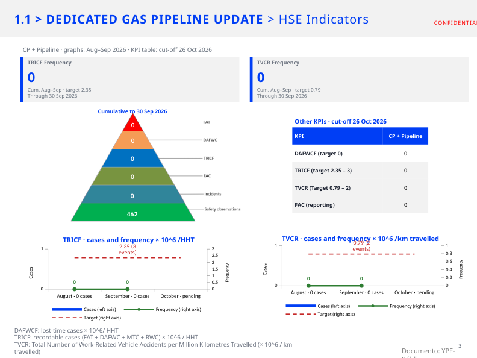
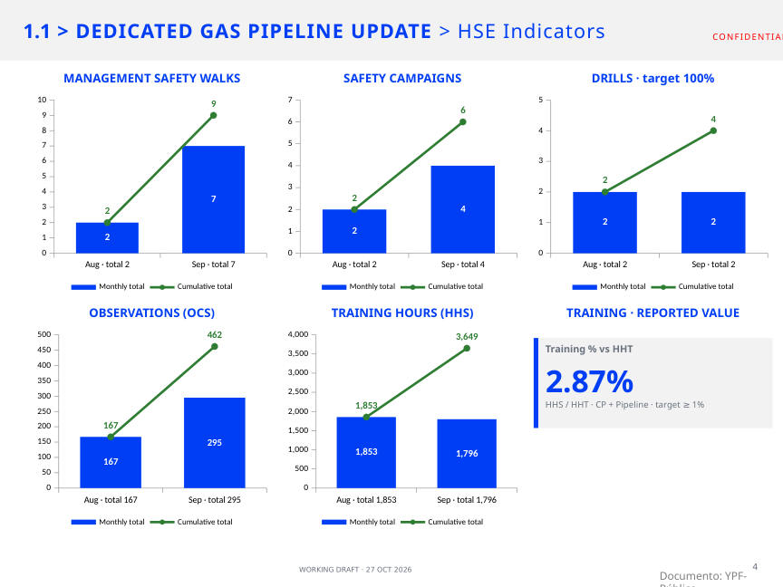
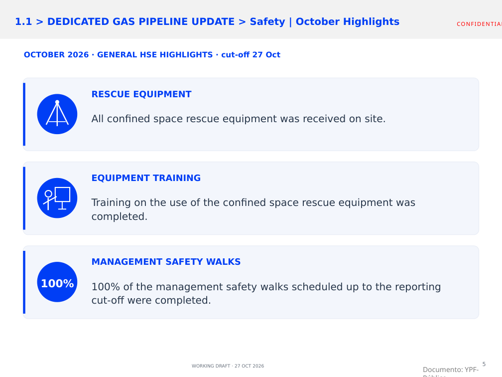

# Informe HSE — octubre 2026

> Entrega vigente: v14, basada en el último archivo adjunto; 7 láminas, con The End al final. Las referencias a versiones anteriores más abajo son antecedentes.

Versión vigente: **v14, borrador de trabajo**, corte solicitado al **27/10/2026**.

- [PowerPoint editable v14](entregables/SMP_HSE_Octubre_2026_v14_INTERLINEADO_CORREGIDO.pptx)
- [PDF para revisión](entregables/SMP_HSE_Octubre_2026_v14_INTERLINEADO_CORREGIDO.pdf)
- [Registro de comentarios y decisiones](entregables/MEMORIA_REVISION_OCTUBRE_2026.md)
- [Presentación original conservada](original/2026.10.26_Technical%20Committee%20SMP%20No5_YPF%20slides_v2_3.pptx)

Se conservaron las series de los siete gráficos y los siete libros incrustados del original. Se quitaron ceros decimales innecesarios, manteniendo valores fraccionarios como 2.35 y 0.79.

Orden de edición: gráficos de seguridad → fotos y novedades de seguridad → gráficos ambientales reconstruidos de la captura → fotos y novedades de ambiente.

La lámina 5 contiene los tres temas generales de seguridad informados por el usuario, sin fotos. La actualización del helicóptero sigue pendiente. Los valores de ambiente reproducen la captura suministrada y son históricos de agosto–septiembre.

Para descargar el PowerPoint desde su página de GitHub, utiliza **Download raw file**.

## Comprobación visual de capacitación

La lámina 4 muestra **2.87%**, en azul. Esta versión tiene un nombre nuevo para distinguirla de descargas anteriores.

## Novedades ambientales incorporadas en v04

Se mantiene la referencia estadística al 30/09 y todos los gráficos sin cambios, incluido el 2.87% de capacitación. La lámina 7 resume la aprobación de la adenda de Allen y su pendiente de Stack Frío, y la gestión con Serman ante SSRH por el permiso hídrico de Neuquén. Fuente: capturas de correos del 26/10/2026. No se afirma ausencia de incidentes ni aprobación del permiso hídrico.

## Revisión v05 sobre el último archivo del usuario

Se corrigió el orden para agrupar seguridad y ambiente con sus novedades. La lámina ambiental incorpora los dos temas del correo de Nicolás y elimina los recuadros opcionales de fotos. Se conserva 2.87% y todos los gráficos/datos del archivo adjunto. Las fotos y novedades de seguridad y la actualización del helicóptero siguen pendientes.

## Lámina ambiental final independiente

- [PowerPoint de una lámina](entregables/SMP_Medio_Ambiente_Lamina_Final_27Oct2026.pptx?raw=true)
- [PDF de la lámina](entregables/SMP_Medio_Ambiente_Lamina_Final_27Oct2026.pdf)

Incluye expresamente el pendiente de Stack Frío y el permiso hídrico de Neuquén. La PPT completa v05 también queda actualizada.

## Presentación general integrada v06

Entrega vigente: la PPT general de 9 láminas, con Allen y Neuquén incorporados en la sección ambiental posterior a sus estadísticas. No es la lámina individual. Se conserva 2.87% y todos los datos. Permanecen pendientes los temas/fotos de seguridad y la actualización del helicóptero.

## Cambio vigente v07

A pedido del usuario se omiten de la PPT general el permiso hídrico de Neuquén y la adenda Allen/Stack Frío. Se retira la lámina narrativa que contenía esos dos temas, conservando los gráficos ambientales y el 2.87% de capacitación. La entrega actual tiene 8 láminas. Las versiones y láminas ambientales enlazadas más arriba son antecedentes y contienen el texto que se pidió omitir.

## Cambio vigente v08

Se omite también la lámina de indicadores ambientales de residuos y consumo de agua. La presentación general vigente queda con 7 láminas, sin los dos bloques ambientales retirados por el usuario. Se mantienen los siete gráficos de seguridad y el 2.87% de capacitación.

## Cambio vigente v09

Se edita únicamente la lámina 5: se eliminan las fotos y se incorporan tres ítems generales —recepción del equipamiento de rescate en espacios confinados, entrenamiento con ese equipamiento y 100% de caminatas gerenciales programadas hasta el corte—. El resto de la PPT permanece sin cambios.

## Cambio vigente v10

Se incorporan cuatro ceros en la tabla Other KPIs, con corte 26/10/2026 confirmado por el usuario. Se agrega una lámina de cierre The End como última página. Los gráficos históricos y las otras láminas existentes se conservan, incluido 2.87% y los tres temas generales de seguridad.

## Cambio vigente v11

Se corrige únicamente el espaciado de los ítems 1.1–1.4 de la agenda. Se elimina el tabulador y el espacio final con tamaño de letra distinto; interlineado uniforme. Contenido y demás láminas sin cambios.

## Cambio vigente v12

Se usa como base el último archivo del usuario (7 láminas). En los cinco gráficos de barras de la lámina 4 se elimina la categoría vacía Oct · pending; solo se muestran agosto y septiembre, conservando todos sus valores y el 2.87%. Las demás ediciones del archivo adjunto se mantienen, incluido The End al final.

## Cambio vigente v13

Se rediseña solo la lámina 5: tres tarjetas con iconos editables, títulos breves y 100% destacado. Se preservan literalmente las tres frases, el formato 4:3, los colores y el encabezado/pie. No se agregan fotos ni hechos; las otras seis láminas y todas las notas permanecen iguales.

## Cambio vigente v14

Interlineado uniforme entre los cuatro ítems de agenda, incluido 1.3–1.4. Se elimina el tabulador y espacio final de 32 pt. Se conserva la v13 como base: tarjetas de seguridad, gráficos solo agosto/septiembre y resto de contenido sin cambios.
